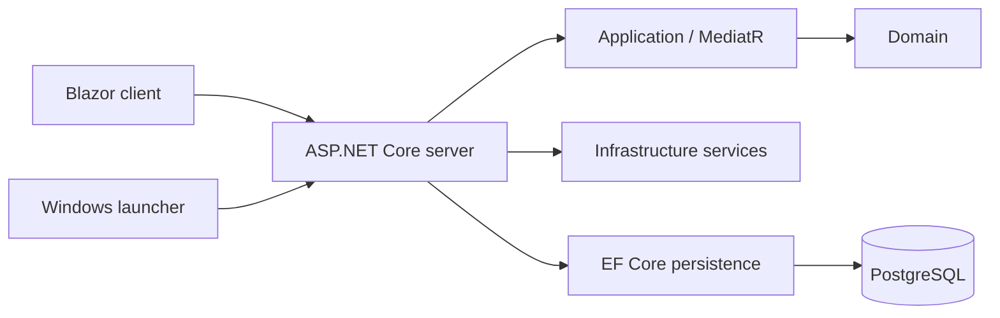

# DentalLocal

DentalLocal is a local dental-practice application built with .NET 10, Blazor WebAssembly, EF Core, and PostgreSQL. Source modules cover patients, visits, treatment plans, payments, materials, reports, a 2D/3D odontogram, backup services, and a Windows launcher. Presence of source modules does not establish that the complete installed workflow works.

## Architecture



The installer publishes the client into the server static files and packages the launcher. See [architecture](docs/ARCHITECTURE.md) and [installer instructions](installer/README.md).

## Development setup

Requires .NET SDK 10. The server expects PostgreSQL on port 5544 or a portable PostgreSQL distribution in `Database/pgsql`. Set `ConnectionStrings__Default` for a disposable local database; `Password=CHANGE_ME` in the committed configuration is a placeholder.

```powershell
dotnet restore src/DentalLocal.Server/DentalLocal.Server.csproj
dotnet build src/DentalLocal.Server/DentalLocal.Server.csproj
dotnet run --project src/DentalLocal.Server
dotnet run --project src/DentalLocal.Client
```

The server and client run separately during development. The Windows installer additionally requires Inno Setup and portable PostgreSQL binaries. See [setup](docs/SETUP.md).

## Tests and current limitations

Unit and application tests are under `tests/`; integration tests use Testcontainers and require Docker. Run `dotnet test DentalLocal.slnx` in a suitable Windows environment. The missing backup contracts and handlers have been restored and the server-only build passes. Backup/restore remains unverified on an isolated PostgreSQL copy, so the application is **not ready for a safe medical-data demonstration**. No patient data or credentials should be placed in the repository.

The initial local access code is shared and documented in source (`111111`); it does not provide individual accountability. See [security](docs/SECURITY.md), [testing](docs/TESTING.md), and [known limitations](docs/KNOWN_LIMITATIONS.md). Real screenshots and a verified restore test are pending.

**Status: development; server build passes, full Windows solution and restore workflow unverified.**
