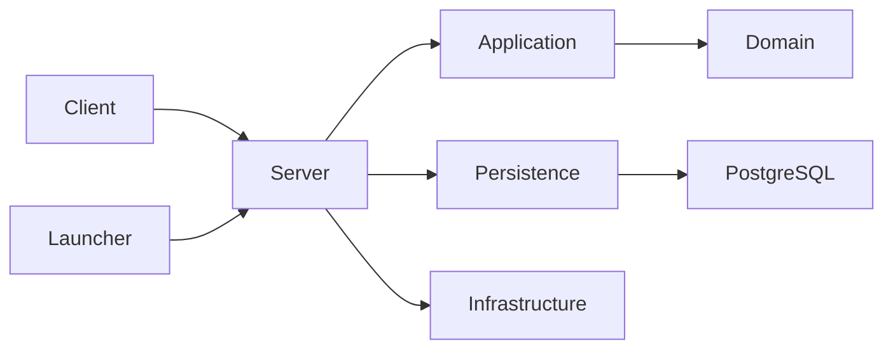

# Architecture

`DentalLocal.Domain` holds entities and repository interfaces. `DentalLocal.Application` implements MediatR commands, queries, validators, and pipeline behaviors. `DentalLocal.Persistence` provides EF Core repositories and migrations. `DentalLocal.Infrastructure` provides backup, auth, export, and local PostgreSQL services. `DentalLocal.Server` maps Minimal API endpoints. `DentalLocal.Client` is Blazor WebAssembly, `DentalLocal.Shared` holds DTOs, and `DentalLocal.Launcher` is a Windows entry point.

The 3D odontogram loads GLB models through JavaScript/Three.js when mounted. The 2D view is separate. The backup endpoint now has Application handlers and Shared contracts; its destructive restore path still requires an isolated end-to-end test. Earlier design references in `CLAUDE.md` point to files absent from this checkout; treat that file as historical guidance, not proof of runtime behavior.
